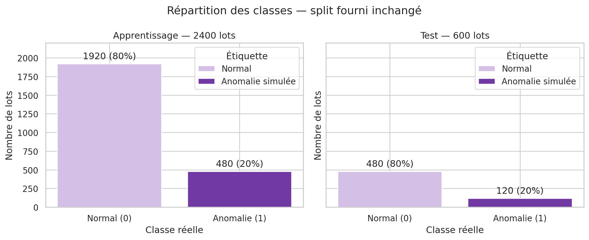
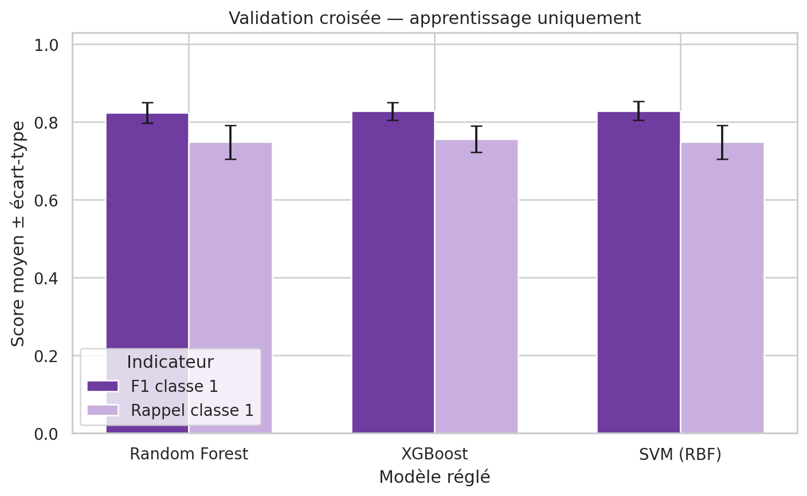
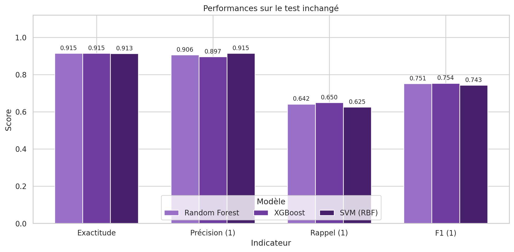
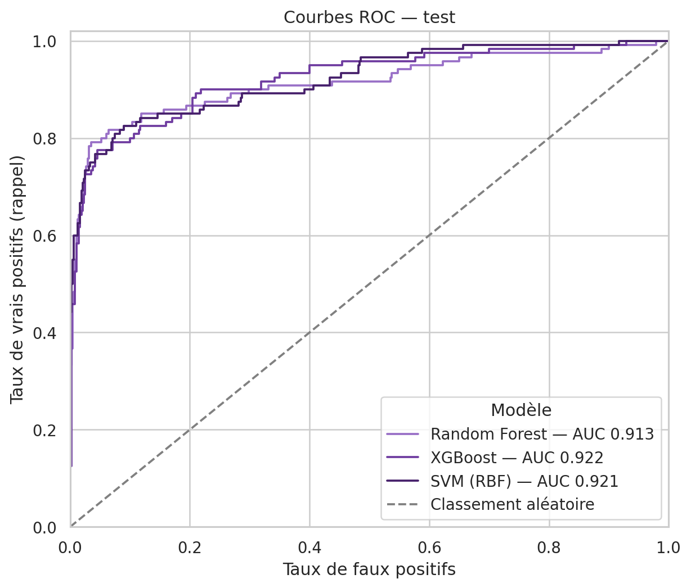
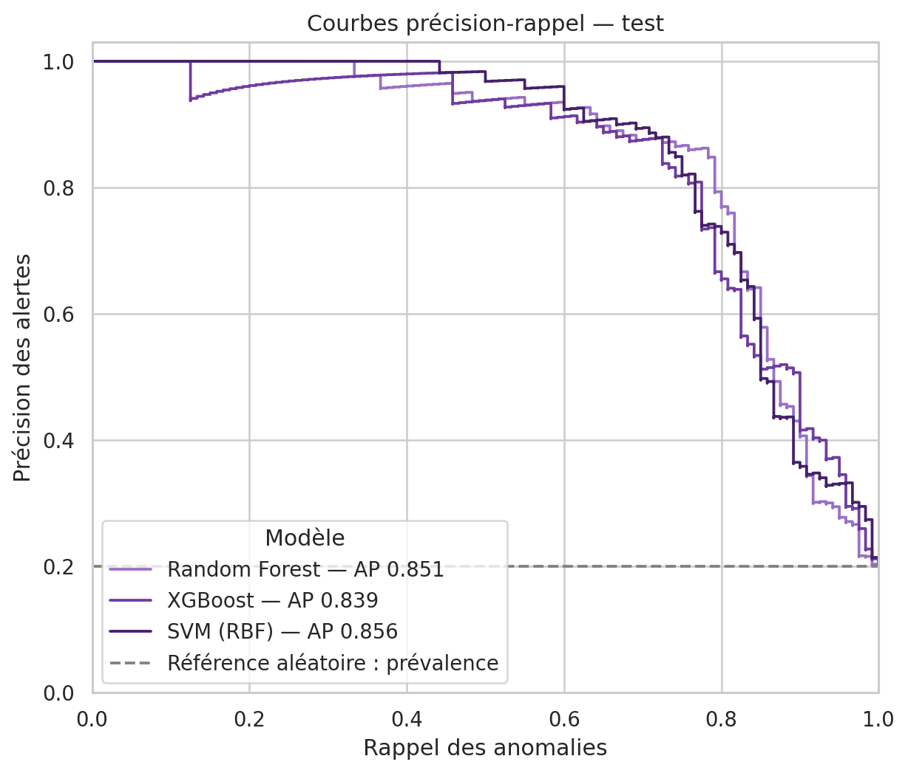
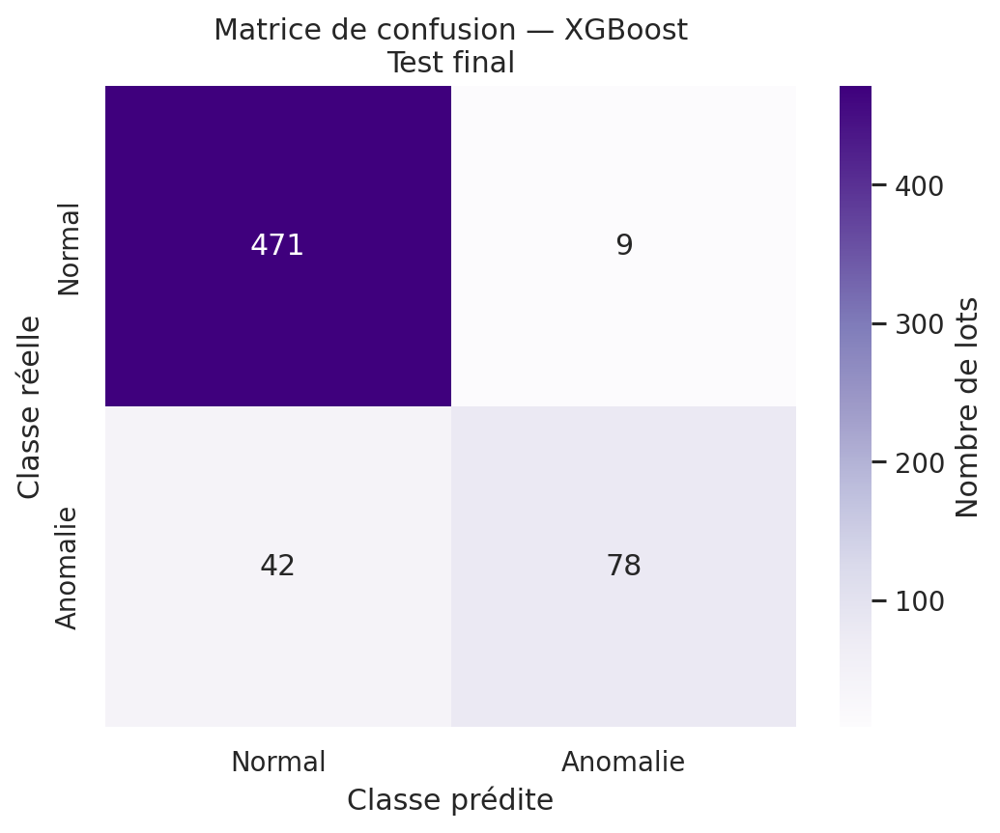
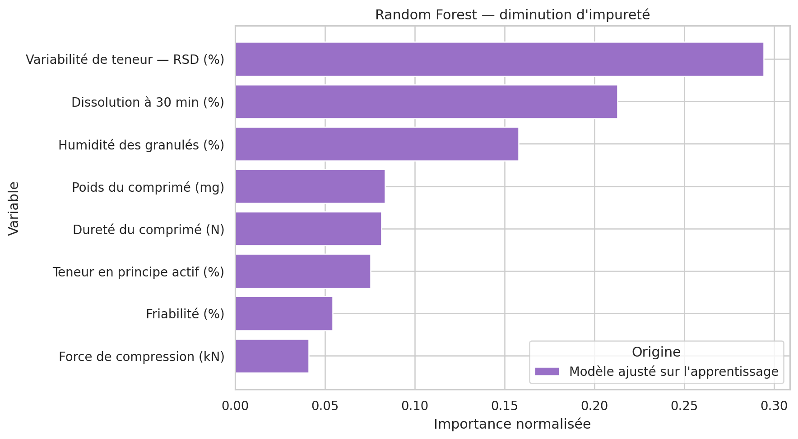
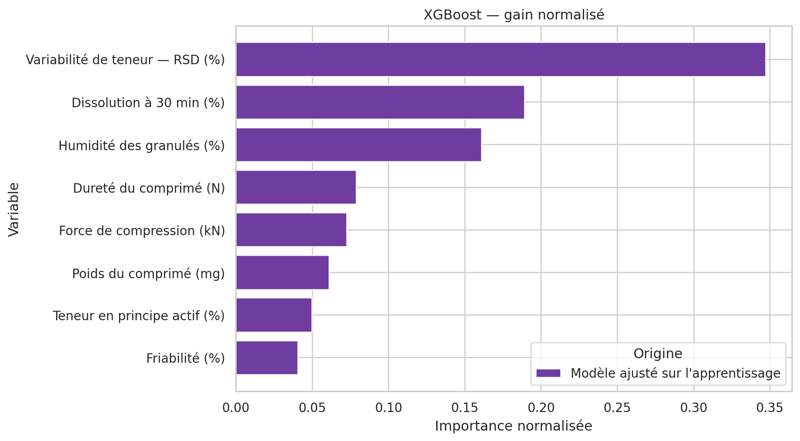
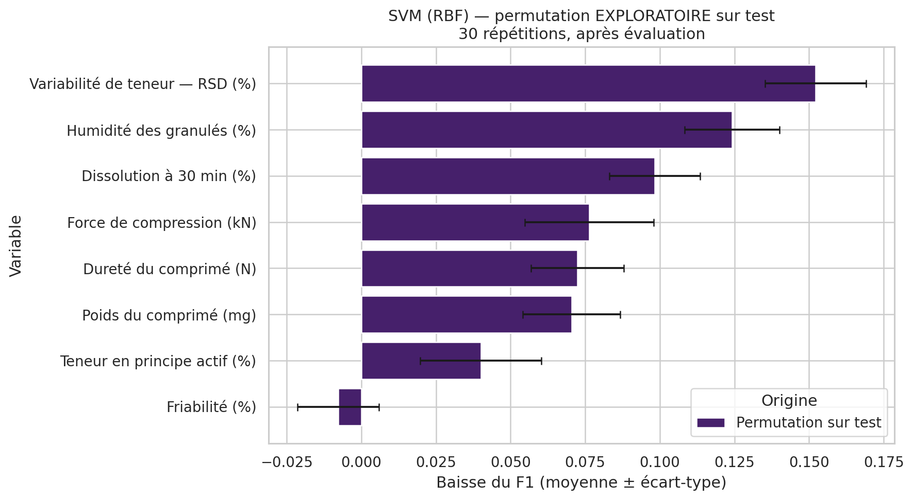

# PharmaCheck — rapport de reconstruction et d'évaluation

> Projet universitaire sur données synthétiques. Une prédiction n'est pas une non-conformité pharmaceutique confirmée.

## Conclusion

Le modèle recommandé est **SVM (RBF)**, choisi uniquement par le F1 moyen de validation croisée (0.8285), puis le rappel en cas d'égalité exacte. Cette sélection est sauvegardée avant l'évaluation du test.

Sur le test, ce modèle obtient F1=0.7426, rappel=0.6250 et précision=0.9146. Il manque 45 anomalies et produit 7 fausses alertes.

Meilleur F1 descriptif sur le test : XGBoost. Meilleur rappel descriptif : XGBoost. Ces constats ne modifient pas le choix.

## Données et audit

Les CSV originaux sont rechargés séparément. Les 2 400 observations d'apprentissage (1 920 normales, 480 anomalies) et les 600 observations du test (480 normales, 120 anomalies) restent inchangées. Aucune suppression de ligne, aucun rééchantillonnage et aucune redistribution entre fichiers.

Valeurs manquantes : 0 dans l'apprentissage et 0 dans le test. Doublons de lignes : 0 et 0. Chevauchement : {'identifiants': 0, 'mesures': 0}.

Les en-têtes, types numériques, dates, cibles binaires, valeurs infinies et incohérences physiques élémentaires sont contrôlés. Les valeurs atypiques plausibles sont conservées. Une teneur supérieure à 100 % n'est pas automatiquement invalide car elle peut se rapporter à une valeur nominale. Aucun seuil de conformité réglementaire n'est inventé.

Variables utilisées par les trois modèles :

- `force_compression_kN`
- `humidite_granules_pct`
- `poids_comprime_mg`
- `durete_comprime_N`
- `friabilite_pct`
- `dissolution_30min_pct`
- `teneur_principe_actif_pct`
- `variabilite_teneur_rsd_pct`

Les identifiants et dates sont exclus. La classe positive est etiquette_anomalie=1.



## Prétraitement et sélection

Chaque modèle est une Pipeline avec imputation médiane ajustée dans chaque pli d'apprentissage. SVM ajoute StandardScaler dans sa Pipeline. Ni médianes, ni échelles, ni variables ne sont sélectionnées sur le test.

StratifiedKFold, 5 plis, mélange et random_state=42. Les mêmes plis sont utilisés pour les baselines et toutes les grilles. Baselines : Random Forest 300 arbres; XGBoost 300 arbres, profondeur 3, learning_rate=0,1; SVM RBF C=1 et gamma='scale'. La recherche complète compare 12 + 24 + 24 = 60 configurations.

| nom | baseline_f1 | baseline_recall | cv_f1_moyenne | cv_f1_ecart_type | cv_recall_moyenne |
| --- | --- | --- | --- | --- | --- |
| Random Forest | 0.8194 | 0.7458 | 0.8237 | 0.0259 | 0.7479 |
| XGBoost | 0.8240 | 0.7583 | 0.8275 | 0.0232 | 0.7562 |
| SVM (RBF) | 0.8283 | 0.7313 | 0.8285 | 0.0242 | 0.7479 |

Le meilleur F1 moyen est prioritaire; le rappel moyen départage les égalités. Chaque candidat choisi est réajusté sur tout l'apprentissage. Les seuils restent 0,5 pour les arbres et frontière de décision 0 pour SVM. Aucun early stopping ni réglage de seuil n'utilise le test. Les écarts-types entre plis ne sont pas des intervalles de confiance. Cette CV de réglage n'est pas imbriquée; ses meilleurs scores peuvent être optimistes.



### Réglages retenus

```json
{
  "random_forest": {
    "classifier__class_weight": null,
    "classifier__max_depth": null,
    "classifier__min_samples_leaf": 3
  },
  "xgboost": {
    "classifier__learning_rate": 0.1,
    "classifier__max_depth": 2,
    "classifier__n_estimators": 400,
    "classifier__scale_pos_weight": 1
  },
  "svm": {
    "classifier__C": 10,
    "classifier__class_weight": null,
    "classifier__gamma": 0.1
  }
}
```

## Résultats finaux sur le test

| modele | nom | accuracy | precision | recall | f1 | roc_auc | pr_auc_ap | vrais_negatifs | faux_positifs | faux_negatifs | vrais_positifs |
| --- | --- | --- | --- | --- | --- | --- | --- | --- | --- | --- | --- |
| random_forest | Random Forest | 0.9150 | 0.9059 | 0.6417 | 0.7512 | 0.9132 | 0.8511 | 472 | 8 | 43 | 77 |
| xgboost | XGBoost | 0.9150 | 0.8966 | 0.6500 | 0.7536 | 0.9219 | 0.8392 | 471 | 9 | 42 | 78 |
| svm | SVM (RBF) | 0.9133 | 0.9146 | 0.6250 | 0.7426 | 0.9211 | 0.8560 | 473 | 7 | 45 | 75 |

Précision, rappel et F1 concernent la classe 1, avec zero_division=0. Un modèle toujours normal aurait 80 % d'exactitude mais un rappel et F1 nuls. ROC-AUC et AP sont calculés sur des scores continus : probabilités non calibrées des arbres et score de décision SVM, qui n'est pas une probabilité. AP correspond à Average Precision de Scikit-learn, sans intégration trapézoïdale. Sa référence aléatoire est la prévalence du test, 0,20.







### Random Forest

```text
              precision    recall  f1-score   support

  Normal (0)     0.9165    0.9833    0.9487       480
Anomalie (1)     0.9059    0.6417    0.7512       120

    accuracy                         0.9150       600
   macro avg     0.9112    0.8125    0.8500       600
weighted avg     0.9144    0.9150    0.9092       600

```


### XGBoost

```text
              precision    recall  f1-score   support

  Normal (0)     0.9181    0.9812    0.9486       480
Anomalie (1)     0.8966    0.6500    0.7536       120

    accuracy                         0.9150       600
   macro avg     0.9073    0.8156    0.8511       600
weighted avg     0.9138    0.9150    0.9096       600

```



### SVM (RBF)

```text
              precision    recall  f1-score   support

  Normal (0)     0.9131    0.9854    0.9479       480
Anomalie (1)     0.9146    0.6250    0.7426       120

    accuracy                         0.9133       600
   macro avg     0.9139    0.8052    0.8452       600
weighted avg     0.9134    0.9133    0.9068       600

```


## Importance des variables

Random Forest utilise la diminution d'impureté; XGBoost le gain normalisé. Les importances proviennent des modèles ajustés sur l'apprentissage, ne sont pas directement comparables entre méthodes et ne sont pas causales.





La permutation SVM est calculée **sur le test après l'évaluation finale**, avec 30 répétitions, F1 classe 1 et random_state=42. C'est une analyse **exploratoire**, qui ne sert à sélectionner ni variables, ni paramètres, ni modèle. Les barres représentent moyenne et écart-type des baisses de F1, sans intervalle de confiance. Les valeurs négatives sont conservées. Des variables corrélées peuvent rendre ces permutations peu représentatives.



## Compromis opérationnel et limites

Un faux négatif manque une anomalie simulée. Un faux positif déclenche une investigation inutile. Augmenter le rappel peut accroître les alertes. Le F1 ne représente pas les coûts réels; aucun coût économique ou seuil acceptable n'est supposé. Tout seuil opérationnel devrait être développé sur des données de validation puis évalué sur un nouvel échantillon indépendant.

- Les données sont synthétiques : aucune validation industrielle ou pharmaceutique réelle n'est démontrée.
- Le test contient seulement 120 anomalies; les faibles écarts ne prouvent pas une supériorité statistique.
- Les dates se chevauchent entre fichiers. Ce split ne valide pas la généralisation temporelle ou à d'autres sites.
- Les grilles sont limitées; les scores CV sélectionnés peuvent être optimistes.
- Les labels simulés et huit variables ne décrivent pas nécessairement toute la qualité des lots.
- Une utilisation réelle exigerait données représentatives, validation externe et temporelle, surveillance de dérive et validation pharmaceutique formelle. Les modèles ne remplacent pas le contrôle qualité.

## Interface et nouvelles expériences

L'interface Streamlit violette accepte de nouveaux CSV et des lots saisis individuellement. Des étiquettes confirmées sont nécessaires pour évaluer ou réentraîner. Les expériences sont isolées dans experiments/, avec CV interne et versions distinctes. Les lots du test initial sont bloqués à l'apprentissage. Une hausse du F1 CV ne garantit pas une amélioration sur de nouvelles données indépendantes.

## Reconstruction et traçabilité

Cette archive a été reconstruite à partir des CSV originaux et du cahier des charges de la conversation; elle n'est pas présentée comme une copie binaire de l'archive perdue. Tous les résultats ci-dessus ont été recalculés.

Exécution UTC : 2026-11-12T22:25:00.302874+00:00. Versions : {'python': '3.12.14', 'numpy': '2.3.5', 'pandas': '2.2.3', 'scikit-learn': '1.8.0', 'xgboost': '3.1.3', 'matplotlib': '3.10.8', 'seaborn': '0.13.2', 'joblib': '1.5.3', 'scipy': '1.17.0'}.

SHA-256 apprentissage : `e2b43273e92e96fb8cc6e01c06d0b52ec710f60f191f58e55e5546396a97cdc8`.

SHA-256 test : `bdcc28b09b20caf672525242dceca59699840a95eb7d9e1f555acf735451d07b`.

Les Pipelines sont sauvegardées avec leurs prétraitements. Les métadonnées conservent les versions, empreintes, paramètres et critères. predictions_test.csv conserve l'ordre des lots, leurs identifiants, étiquettes réelles, prédictions et scores des trois modèles. Les fichiers de recherche conservent les configurations et scores par pli.
